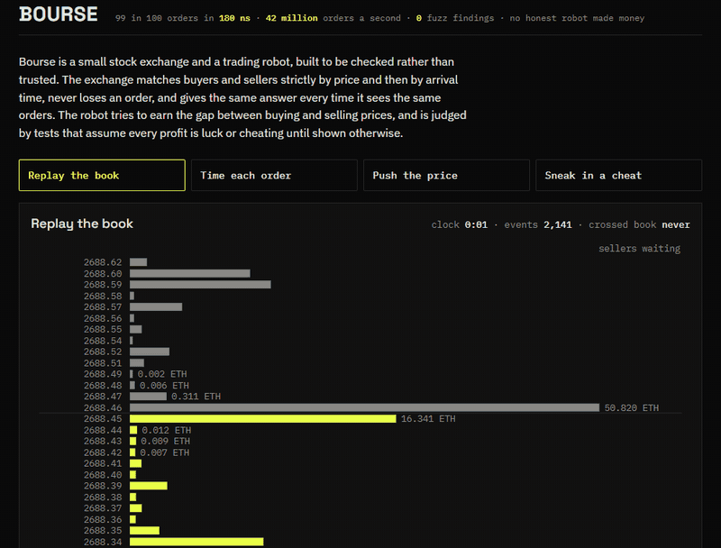
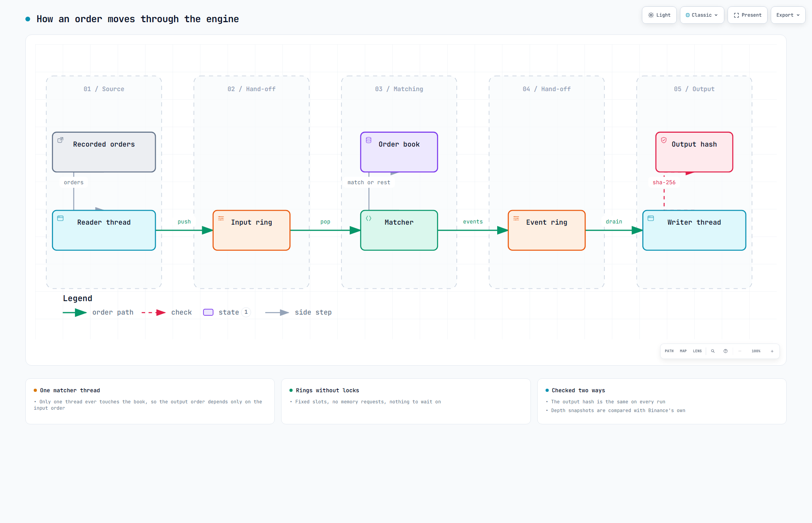
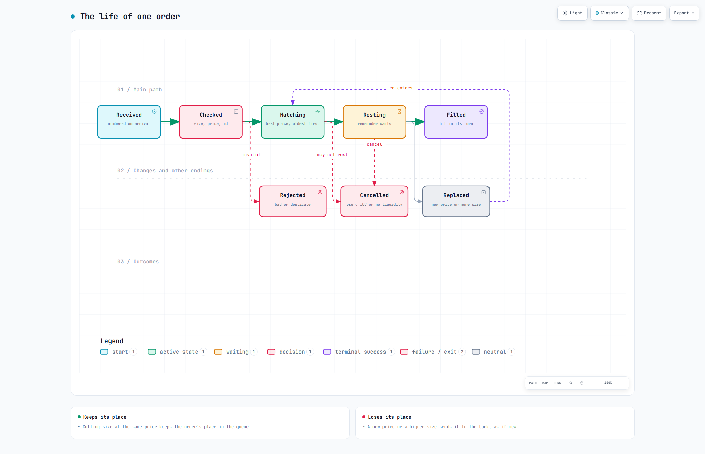
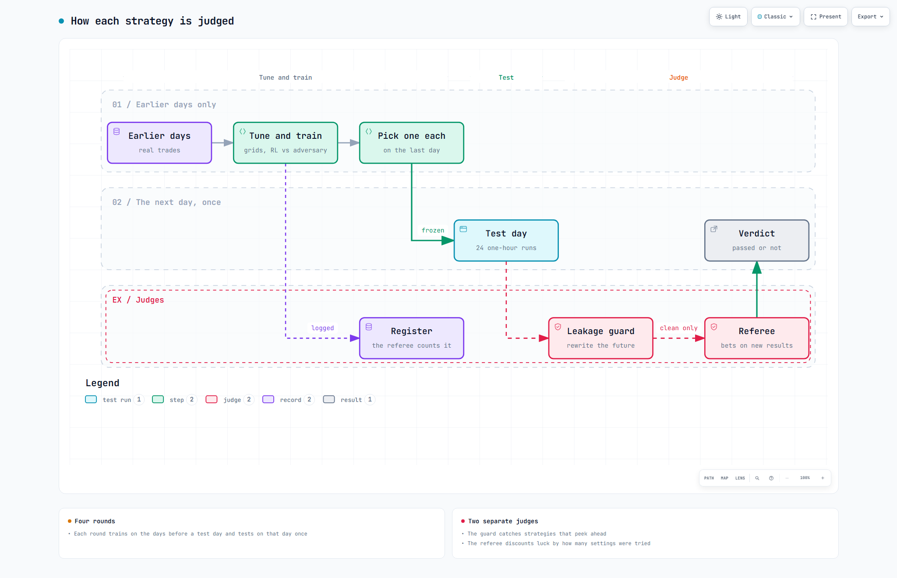

# Bourse

Bourse is a small stock exchange and a trading robot, built to be checked rather than trusted. The exchange matches buyers and sellers strictly by price and then by arrival time, never loses an order, and gives the same answer every time it sees the same orders. The robot tries to earn the gap between buying and selling prices. It is judged by tests that treat every profit as luck or cheating until shown otherwise, and none of the honest robots made money.

**Demo:** [samad-zeeshan.github.io/Bourse](https://samad-zeeshan.github.io/Bourse/) replays three minutes of Binance's order book through the engine inside your browser, then shows its speed, a price impact experiment, and a cheating robot being caught. A 90-second walkthrough is in [docs/media/demo.mp4](docs/media/demo.mp4).



## How it works

-  One thread owns the order book, and orders reach it and leave it through lock-free queues, so the output depends only on the input.
-  An order is checked, matched against the best waiting prices, and then rests, fills, is cancelled or is replaced.
-  Each strategy is tuned on earlier days, tested once on the next day, and then judged by a leakage check and a referee that knows how many settings were tried.

Each has an interactive version beside it in `docs/diagrams/`.

## Speed

<!-- gen:speed -->
| Engine | Machine | Median | 99th percentile | 99.9th percentile | Slowest | Orders per second |
|---|---|---|---|---|---|---|
| Bourse, matcher alone | AMD Ryzen 5 7600X3D, Windows PC | 40 ns | 180 ns | 280 ns | 54.4 µs | 42 million |
| Bourse, three threads with queues | same | | | | | 25 million |
| exchange-core at 1 million a second | Xeon X5690, tuned server | 0.5 µs | 4 µs | 22 µs | 45 µs | published |
| exchange-core at 5 million a second | Xeon X5690, tuned server | 1.5 µs | 42 µs | 150 µs | 190 µs | published |
<!-- /gen -->

<!-- gen:speed-summary -->
Half of all orders were handled in 40 nanoseconds or less, and 99 in 100 in 180 or less. That is under the one microsecond the project aimed for. One thread handled about 42 million orders a second, well above the goal of one million.
<!-- /gen -->
Each order was timed alone with the processor's cycle counter, with no network or disk involved. The other engine's numbers include risk checks and queueing at a fixed offered rate on a tuned server, so they are a rough reference, not a fair race.

<!-- gen:method -->
| Setting | Value |
|---|---|
| Processor | AMD Ryzen 5 7600X3D 6-Core Processor, 12 logical cores |
| System | Microsoft Windows [Version 10.0.26200.9457], power plan High performance |
| Compiler | rustc 1.98.1 (48a229cea 2026-09-01), release profile, fat LTO, one codegen unit |
| Pinning | matcher on logical core 4, time-critical priority, no core isolation |
| Clock | processor time stamp counter, 4.10 ticks per nanosecond |
| Orders | 2,000,000 to warm up, then 20,000,000 timed one by one |
| Timer cost | reported separately and not subtracted |
<!-- /gen -->

## Correctness

The engine promises five things after every order: the best buying price stays below the best selling price, quantity is never created or lost, the best price trades first and the oldest order at that price before newer ones, a cancel removes exactly what was waiting, and every event carries a number one higher than the one before.

<!-- gen:correctness -->
| Check | What it tried | Result |
|---|---|---|
| Property tests against the Python reference book | 3,000 random order streams per run | all match |
| Differential fuzzing against the same reference | 3.7 hours, 0.97 billion orders | 0 disagreements or broken rules |
| TLA+ model of the order life and the hand-off | 541,993 distinct states | no rule broken |
| Same model, tail published before the slot is written | planted bug | caught (HandoffExact) |
| Same model, new orders put at the front | planted bug | caught (FifoWithinLevel) |
| Replay of 5,000,000 orders in 4 separate runs | Windows processes and a Linux container | identical bytes |
<!-- /gen -->

<!-- gen:fuzz-summary -->
The 24-hour fuzz run is still running. So far it has checked 0.97 billion orders over 3.7 hours. It found 0 problems.
<!-- /gen -->
The TLA+ model in `spec/Bourse.tla` covers limit orders, cancels and the hand-off between threads. It does not cover market orders, replaces or self-trade prevention, which only the tests and the fuzzer check. The model is a reading of the code, and code and model can agree on a mistake, which is the gap arXiv 2607.05076 describes.

## Real data

<!-- gen:data-summary -->
The engine's book matched Binance's own snapshot in 238 of 238 checks, on the top 20 price levels each side. That covered 240 minutes of recorded trading.
<!-- /gen -->
LOBSTER's free samples now need an account, so the data is Binance's public ETHUSDT depth stream, recorded for four hours, plus seven days of its public trade archive.

## Order flow and price impact

Market orders arrive in bursts, and a Hawkes process, where each order makes the next one more likely for a while, fits them far better than constant rates do. The fit error below is the largest gap between the model's timing and the real timing, so smaller is better.

<!-- gen:flow -->
| Day | Market orders in two hours | Self-excitation | Fit error, buys | Fit error, sells | Fit error with constant rates | Error using the day before |
|---|---|---|---|---|---|---|
| 2026-09-18 | 80,621 | 0.87 | 0.068 | 0.035 | 0.56 | first day |
| 2026-09-19 | 17,507 | 0.53 | 0.038 | 0.034 | 0.41 | 0.18 |
| 2026-09-20 | 16,857 | 0.59 | 0.032 | 0.040 | 0.52 | 0.12 |
| 2026-09-21 | 67,558 | 0.67 | 0.027 | 0.045 | 0.48 | 0.25 |
| 2026-09-22 | 53,012 | 0.69 | 0.038 | 0.041 | 0.54 | 0.07 |
| 2026-09-23 | 51,276 | 0.73 | 0.037 | 0.038 | 0.61 | 0.06 |
| 2026-09-24 | 38,129 | 0.68 | 0.052 | 0.033 | 0.51 | 0.14 |
<!-- /gen -->

The fit gets worse when one day's model is used on the next day, but it stays well ahead of constant rates.
<!-- gen:synthetic-summary -->
Synthetic days built from these fits match the real ones on order rate, bursts, spread, book depth and volume traded. Prices in them move about 11 times less than real prices, because nothing in the simulation reacts to news.
<!-- /gen -->

<!-- gen:impact -->
| How the order is sent | Exponent | 95% interval | Sizes used in the fit |
|---|---|---|---|
| split into 60 pieces | 0.96 | 0.82 to 1.26 | 6 of 8 |
| split, refills do not follow the price | could not be fitted | | 1 of 8 |
| one order | could not be fitted | | 0 of 8 |
<!-- /gen -->

<!-- gen:impact-summary -->
When a large order was split into 60 pieces, the price moved by its size to the power 0.96, with a 95% interval from 0.82 to 1.26. The square-root law predicts 0.5, so this simulator does not reproduce it.
<!-- /gen -->
A likely reason is that new orders in the simulation arrive at a steady rate and do not rush in after the price moves, while arXiv 2607.04280 finds that this kind of refill is one of the two things the law needs. When refills were held at the old price, impact almost disappeared. A single order swept the visible book before it grew large enough to measure.

## Market making

<!-- gen:strategies -->
| Strategy | Profit per hour, USDT | 95% interval | Hourly Sharpe | Robustness grade | Chance it is luck, after the search | Leakage check |
|---|---|---|---|---|---|---|
| Avellaneda-Stoikov | -3.23 | -4.81 to -1.93 | -0.58 | 20 of 100 | 1.00 | clean |
| Multi-level | -27.64 | -34.46 to -21.58 | -1.09 | 20 of 100 | 1.00 | clean |
| RL candidate | -5.88 | -8.92 to -3.03 | -0.42 | 20 of 100 | 1.00 | clean |
| Planted cheat | 8.36 | 6.06 to 11.00 | 0.90 | 60 of 100 | 0.00 | refused, reads the future |
<!-- /gen -->

<!-- gen:strategy-summary -->
No honest strategy made money once the test day came. The trained candidate lost 5.9 USDT an hour on average, and the Avellaneda-Stoikov baseline lost 3.2. The candidate did worse than the baseline by 2.7 USDT an hour, with an interval from -4.86 to -0.33. So it is worse, and the interval excludes zero. The planted cheat made 8.4 USDT an hour and passed the referee, but the leakage check refused it.
<!-- /gen -->
A quote here fills only when a market order trades straight through its price, as if it were last in the queue. That makes every fill a sign that the price is moving against the robot, which is harsh but honest. The grade follows the recipe in arXiv 2608.23808 but not its calibration, so it ranks these strategies against each other and nothing else.
<!-- gen:fee-summary -->
With a fee of one hundredth of a percent on each fill, every strategy loses more. The cheat then loses too, 4.0 USDT an hour.
<!-- /gen -->

## Research note

**Hypothesis.** A market maker trained against a worst-case market earns more on unseen days than the Avellaneda-Stoikov formula.

**Method.** Four rounds. Each round tunes every strategy on the days before a test day, picks one setting per strategy on the last of those days, and runs it once on the test day in 24 one-hour pieces.
<!-- gen:register-summary -->
Every setting tried, 412 in all, is logged before any test result is seen.
<!-- /gen -->
A betting referee judges only results that arrive after that point and divides by the number of settings tried.

**Result.** It does not. The candidate lost more than the baseline, and the difference excludes zero. No honest strategy earned money, and only the planted cheat looked profitable.

**What would break it.** The fill rule may be too strict. A quote that sometimes fills at the front of its queue could turn the baselines positive. Seven days of one symbol is a narrow sample, and the policy is a small linear one, not the paper's neural network.

**What to test next.** Recorded queue positions from a full order-by-order feed, a policy with memory, and fees negative enough to pay a market maker for waiting.

## Design decisions

- Rust for the engine, with no dependencies in the core crate. Prices are whole ticks and sizes whole lots, so there is no rounding anywhere.
- Every structure is sized when the book is built: a price ladder, a slab of order slots and a fixed id table. A test proves two million orders allocate nothing.
- A size cut at the same price keeps an order's place in the queue. Any other replace sends it to the back.
- The reinforcement learning candidate was cut down to run on one PC in minutes: a linear policy, evolution strategies instead of gradient methods, and an adversary that picks the worst of eight fixed market regimes each round.
- The planted cheat's strength was chosen by looking at one test day, which is allowed only because it is a cheat.

## Run it

```
cargo test --release --workspace                  # engine, property tests against Python, determinism
cargo run --release -p bench                      # timing on your machine, writes bench/results.json
python eval/report.py --check                     # README and demo numbers match the result files
```

The Python steps need `pip install -r requirements.txt`. `flow/calibrate.py`, `flow/sqrt_law.py` and `eval/mm/harness.py` rebuild the flow and strategy results, and `spec/check.py` reruns TLC.

## Papers

- arXiv 2609.22785, Robust Market Making with Hawkes Order Flow and Price Impact. The flow model and the adversarial candidate.
- arXiv 2608.13096, FlowLOB. Cited for synthetic order books, not reproduced.
- arXiv 2608.19227, M3. Cited as another way to generate order flow, not reproduced.
- arXiv 2607.04280, Order Splitting and Liquidity Replenishment and the square-root law. The impact experiment.
- arXiv 2606.29556, Persona-Trained Monte Carlo. Cited for mixed traders, not built.
- arXiv 2606.21784, KineticSim. Speed reference for market simulators.
- arXiv 2608.18195, Multi-Level Market Making with Reinforcement Learning. The multi-level baseline.
- arXiv 2606.25986, The Inference-Compute Frontier for order book prediction. Why the candidate stays small and fast.
- arXiv 2608.27734, What survives honest evaluation? Leakage-safe splits, the planted cheat and search-aware deflation.
- arXiv 2608.23808, The MinervaScore. The robustness grade.
- arXiv 2609.27051, Propose, Don't Judge. The betting referee.
- arXiv 2607.05076, Can Code Specify a System Precisely Enough to Formally Verify It? What the model covers and what it does not.

## Licence

MIT, see [LICENSE](LICENSE). Binance market data is used under Binance's terms of use, and raw recordings are not redistributed.
